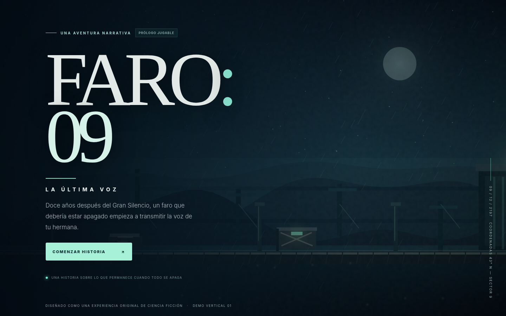
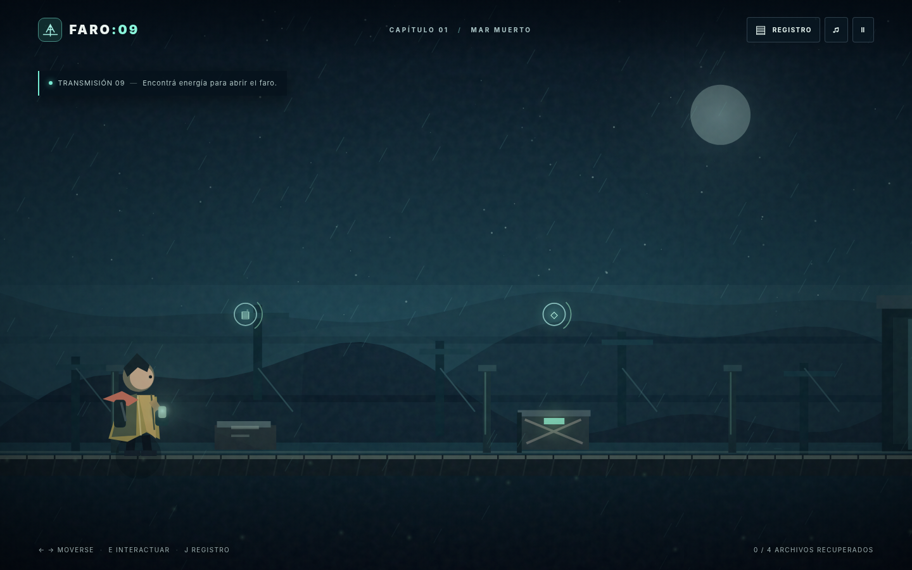
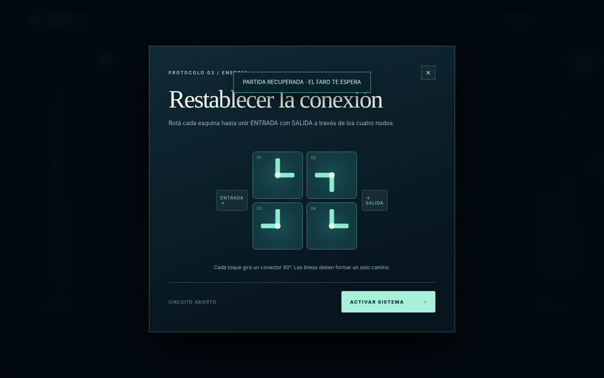
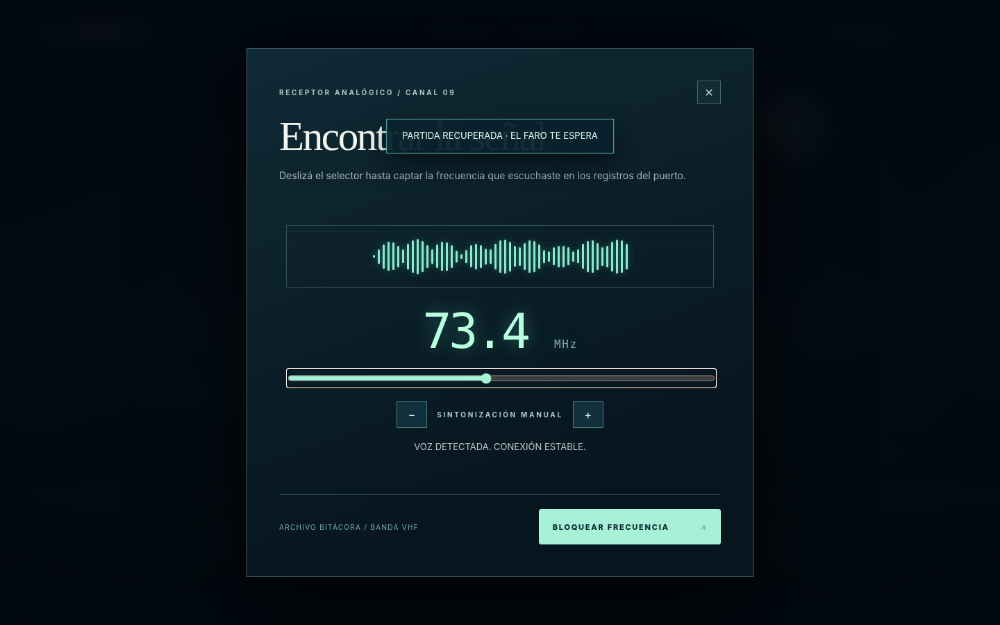
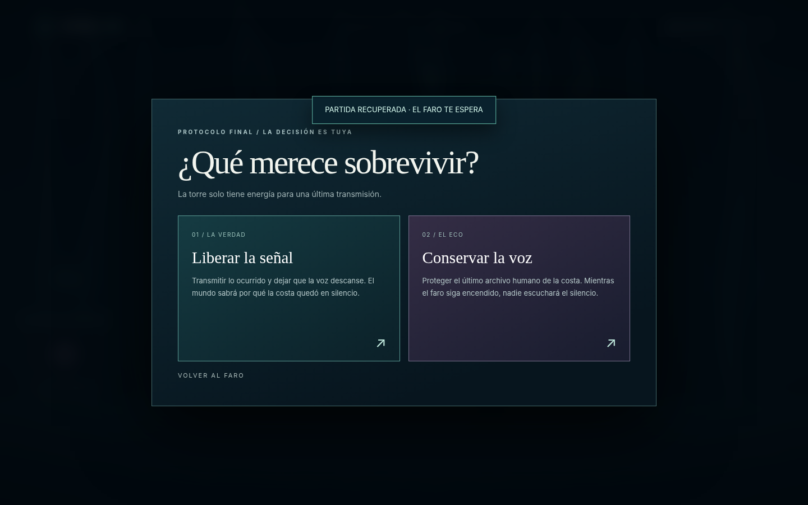

<div align="center">

# FARO:09
### LA ÚLTIMA VOZ

**Una aventura narrativa de misterio y ciencia ficción.**

*«Doce años después del Gran Silencio, una voz imposible vuelve a transmitir desde el faro.»*



**[Jugar el prólogo](#-cómo-jugar) · [Historia](#-la-historia) · [Características](#-qué-incluye) · [Publicación](#-publicar-en-netlify)**

    

</div>

---

## ◇ La historia

**Año 2197.** Doce años antes, un fenómeno conocido como el *Gran Silencio* destruyó las comunicaciones de la costa. El faro del Sector Nueve dejó de emitir la misma noche que **Lía**, la hermana de la ingeniera **Vera**, desapareció durante la evacuación.

Una madrugada, la frecuencia vuelve a encenderse.

Y al otro lado se escucha una voz que no debería existir.

Vera regresa al faro para descubrir qué sucedió. Pero la señal no es lo que parece, y las respuestas la obligarán a decidir qué merece sobrevivir: **la verdad o el eco de alguien que ya no está**.

**Temas:** memoria, identidad, pérdida, tecnología y decisiones con consecuencias.

## ◇ Qué incluye

- **Cuatro entornos** que recorren el puerto, las instalaciones, la antena y el núcleo del faro.
- **Exploración lateral**, con movimiento y objetos investigables.
- **Historia interactiva** presentada mediante diálogos cinematográficos.
- **Dos acertijos integrados en la trama:** reconstrucción de un circuito y sintonización de una señal de radio.
- **Cuatro documentos de archivo** para reconstruir lo ocurrido.
- **Dos desenlaces** según una decisión final.
- **Guardado local** del progreso en el navegador.
- **Sonido ambiental sintetizado** con Web Audio y controles de audio.
- **Controles táctiles** y diseño adaptable a celular.
- Arte, interfaz y código originales creados para este prototipo; sin librerías ni imágenes externas necesarias para jugar.

## ◇ Capturas

| Exploración | Interfaz de reparación |
|:---:|:---:|
|  |  |

| Sintonizador | Decisión final |
|:---:|:---:|
|  |  |

## ◇ Cómo jugar

1. Descargá el repositorio o clonalo.
2. Abrí `index.html` en un navegador moderno.
3. Seleccioná **Comenzar historia** y seguí la señal.

**Controles de escritorio**

| Tecla | Acción |
|---|---|
| `A` / `←` | Caminar a la izquierda |
| `D` / `→` | Caminar a la derecha |
| `E` | Interactuar con objetos |
| `Enter` | Continuar diálogos / interactuar |
| `Espacio` | Continuar diálogos |
| `J` | Abrir bitácora |
| `M` | Activar o silenciar audio |
| `Esc` | Pausar / volver |

En teléfonos, el juego incorpora **botones de movimiento e interacción**.

> Consejo: los objetos investigables tienen indicadores luminosos. Acercate para descubrir qué podés hacer.

## ◇ Arquitectura

```text
faro09/
├── index.html          # Estructura y componentes de interfaz
├── styles.css          # Diseño responsive y presentación
├── game.js             # Motor 2D, narrativa, estado, acertijos y sonido
├── favicon.svg         # Identidad visual
├── README.md
├── HISTORIA_Y_ROADMAP.md
└── docs/               # Capturas para documentación
```

**Stack:** HTML5 Canvas 2D, CSS y JavaScript vanilla. No requiere npm, bundler ni backend para la demo.

**Persistencia:** `localStorage`; el progreso se conserva en el navegador/dispositivo en el que se jugó, pero no se sincroniza entre dispositivos.

## ◇ Publicar en Netlify

1. Creá un **nuevo repositorio** para el juego. No reemplaces Pixel Rush ni KYRALUME.
2. Subí los archivos de este directorio a la raíz del repositorio.
3. En Netlify seleccioná **Add new project → Import an existing project**.
4. Conectá GitHub, elegí el repositorio y configurá como **Publish directory** la raíz `.`. No necesitás **Build command**.
5. Publicá. Los próximos commits en la rama configurada podrán desplegarse automáticamente.

También podés usar el despliegue manual arrastrando la carpeta que contiene `index.html` dentro del proyecto de Netlify.

## ◇ Estado del proyecto y futuro comercial

**Esta entrega es una demo vertical jugable**, no un videojuego comercial terminado. Valida la premisa narrativa, el tono visual y el ciclo de exploración, investigación y decisiones.

Para llevarla a una venta real: ampliar la campaña, diseñar animaciones de personajes profesionales, desarrollar más rompecabezas con variedad, crear música original producida, grabar voces si el presupuesto lo permite, agregar accesibilidad y opciones gráficas, preparar pruebas con jugadores, optimizar rendimiento y estudiar la viabilidad comercial y legal de la marca.

La propuesta de producto, narrativa futura y etapas de producción están en **[HISTORIA_Y_ROADMAP.md](HISTORIA_Y_ROADMAP.md)**.

---

<div align="center">

**FARO:09 · LA ÚLTIMA VOZ**

*Una luz puede mostrar el camino. También puede esconder lo que hay al final.*

Demo original de desarrollo independiente · 2026

</div>
